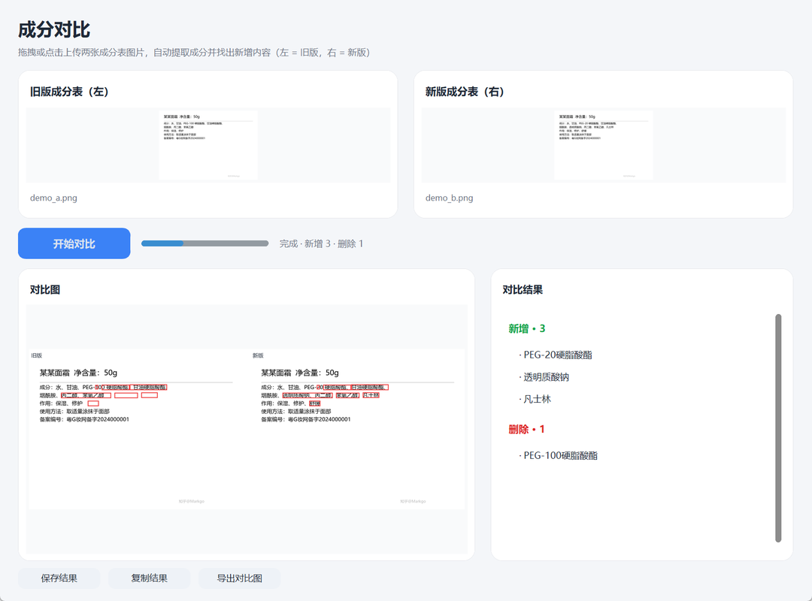

# image-diff · 成分表图片对比

上传两张成分表图片，自动**提取成分**，找出**对比旧版所新增**的内容。完全离线、免费。



- 核心是**可复用的 Python 库**：`from image_diff import compare_images`
- 带**现代图形界面**（CustomTkinter 浅色卡片风），**支持把图片直接拖拽到卡片上**
- 带**命令行**：`image-diff a.png b.png`
- 只聚焦「成分表」：自动从整页文字里只截取「成分 / 配料」这一节，忽略「作用 / 功效 / 使用方法 / 备案号」等

---

## 1. 它能做什么

1. 识别图片 A、B 中的文字（OCR，离线）；
2. 只提取「成分 / 配料 / 成分表 / 配料表 / Ingredients」这一节；若是表格（如「原料举例」列），会自动按坐标识别行标签列与原料列，只取原料列；
3. 把换行拼接起来，按 `、 ， ，；` 切分成成分列表；
4. 对比两份成分，输出 **对比旧版所新增的内容**；
5. 生成 A、B 并排、差异处红框标注的**对比图**。

---

## 2. 安装

### 常规环境

```bash
pip install -e ".[gui,ocr]"
```

### 本机 DSH 沙盒 / 无法写 site-packages 时

依赖已装在仓库内 `.deps/`（不提交 Git）。用 `run_gui.bat` 启动即可，它会自动把 `.deps/` 加入 `PYTHONPATH`。

手动运行：

```powershell
$env:PYTHONPATH = "<仓库路径>\.deps"
python gui.py
```

---

## 3. 使用

### 图形界面

```bash
run_gui.bat        # Windows 双击
# 或
python gui.py
```

流程：把旧版、新版图片分别**拖拽**到左右卡片（或点击选择）→ 「开始对比」→ 左侧看对比图（红框），右侧看「对比旧版所新增的内容」。

### 命令行

```bash
# 成分对比（需要 OCR）
image-diff old.png new.png -o out

# 跳过 OCR，仅像素差异
image-diff old.png new.png -o out --no-ocr

# JSON 输出
image-diff old.png new.png -o out --json

# 调试：输出 OCR 原文与提取明细（排查识别问题）
image-diff old.png new.png -o out --debug
```

输出：`diff_compare.png`（对比图）、`region_*.png`、`report.md`。

### 作为库调用

```python
from image_diff import compare_images

r = compare_images("old.png", "new.png", mode="ingredient", output_dir="out")
print(r.ingredient_diff.added)    # 新增成分
print(r.ingredient_diff.removed)  # 删除的成分（界面不展示，库内仍可用）
print(r.ingredients_a)            # 图片 A 的全部成分
```

---

## 4. OCR 后端

`auto` 模式优先使用已安装的后端：

| 后端 | 安装 | 说明 |
|---|---|---|
| RapidOCR（推荐） | `pip install rapidocr_onnxruntime` | 轻量，内置模型，中英文效果好 |
| PaddleOCR（可选） | `pip install paddlepaddle paddleocr` | 更强，但依赖重 |

用 `IMAGE_DIFF_OCR_BACKEND=rapidocr|paddleocr|auto` 指定。

---

## 5. 目录结构

```
image_diff/         核心库
  align.py          读取与尺寸对齐
  pixel_diff.py     像素差异 + 对比图渲染
  ocr.py            OCR 抽象 + RapidOCR / PaddleOCR
  text_diff.py      归一化 + 成分切分 + 成分 diff
  heuristics.py     成分表识别 + 成分小节提取
  pipeline.py       compare_images 编排
  report.py         Markdown / 纯文本摘要
cli.py              命令行入口
gui.py              图形界面（CustomTkinter）
examples/           演示图片与生成脚本
tests/              测试
run_gui.bat         Windows 启动脚本
```

---

## 6. 测试

```bash
python tests/test_core.py
```

覆盖：成分切分、**跨行成分不被拆断**、成分小节提取、成分 diff、成分表启发式、像素差异、伪 OCR 全流程。

---

## 7. 限制

- 像素对比要求两图大致同源；差异大时准确率下降。
- OCR 准确率受清晰度、光照、倾斜影响。
- 成分按集合对比（忽略先后顺序）；若同一成分名称有极小差异会被判为「删一个、加一个」。
- 单张图统一缩放到最大宽度 1280（`--max-width` 可调）。

---

## 8. 许可

MIT
